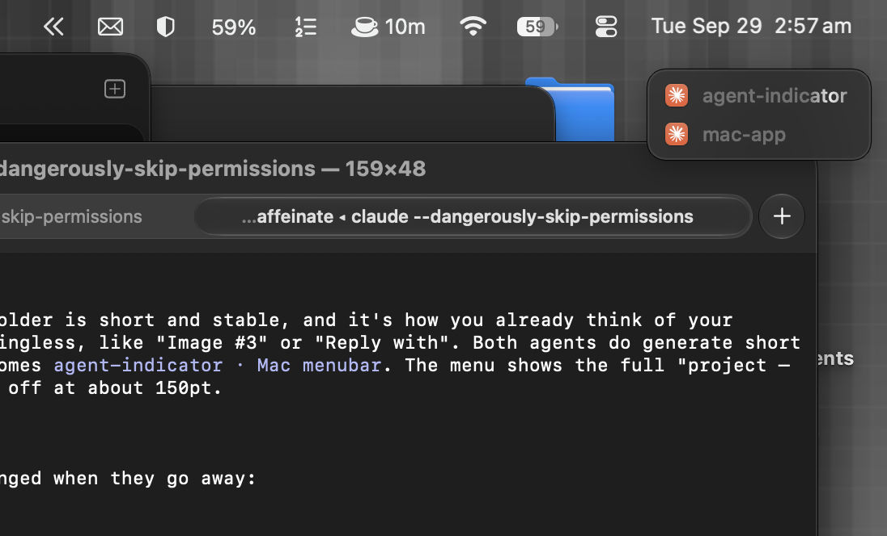

# Agent Indicator

A tiny always-on-top macOS indicator that shows what your **Claude Code** and **Codex** sessions are doing while you're in other apps.



When you switch away from your terminal, you lose sight of whether the agent is still working, waiting on you, or done. Agent Indicator keeps a small translucent list in a corner of the screen with one row per chat:

| Row looks like | Meaning |
| --- | --- |
| Shimmering text + elapsed time | The agent is working (`30s`, `4m`, `1h 5m`). The color comes from the theme |
| Pulsing yellow text | It's waiting for you (permission prompt or question) |
| Shimmering green text | The turn finished while you were away. It keeps shimmering until you move the mouse or type |
| Text at 70% opacity | The turn finished |
| Dim text with “status unconfirmed” (or a **?** icon), no timer | No recent evidence that the agent is working |

A row flashes when its turn finishes or when it starts waiting on you, so you notice even from the corner of your eye. The list resizes to fit the active chats and disappears when nothing is going on.

The menu bar icon mirrors the list: it shows how many chats are working and an orange dot when one needs you. You can hide the floating list entirely and rely on the menu bar alone.

## Features

- **Real time.** File changes trigger updates with a 1.5-second recovery sweep for missed events and closed sessions.
- **Status sounds.** Blow announces when a tracked Claude or Codex turn finishes; Bottle announces when a chat starts waiting for your input, even with the floating list hidden. Existing states loaded at startup and cancelled turns stay silent; chats reaching the same state in one update share one sound.
- **Click to jump.** Clicking a row brings up that session:
  - Terminal.app and iTerm2 select the exact tab.
  - Codex desktop chats open directly with `codex://threads/<id>`.
  - Any other host app (Warp, Cursor, VS Code, Ghostty, the Claude app) is brought to the front.
- **One row per chat.** A new message in the same chat reuses its row, and Codex subagent threads fold into their parent chat.
- **Static agent icons.** The floating bar and menu share the installed apps' icons, with built-in fallbacks for terminal-only setups. Agent logos do not animate.
- **Short labels.** Each row shows the project folder. When two chats share a folder, the first words of the chat title are added.
- **Stays out of the way.** It floats above other windows on every Space, including full-screen apps, and never takes focus.
- **Follows you across displays.** On a multi-monitor setup it moves to the display your pointer is on, or to the one holding the app you just switched to.
- **Zero setup.** It uses no hooks, needs no config changes, and makes no network requests.

## Settings

Everything lives in the menu bar icon:

- **Refresh Sessions** (`⌘R` while the menu is open): rediscover live sessions and reread their logs. Preserves preferences and does not interrupt agents or reset a valid running turn’s clock.

- **Position**: any corner (top right by default) or the middle of any edge. You can also drag the list anywhere, and it snaps to the nearest of these 8 positions when you let go.
  - **Follow Active Display** (on by default): move to the display you're working on instead of staying on the menu-bar display.
- **Layout**: vertical (default) or horizontal.
- **Theme**: the color of working text and its shimmer. Choose Silver (default), Ocean, Sky, Lavender, Rose, Mint or Clay.
- **Labels**: project name (default), chat title, or icons only. Icons Only shows a spinner, pulsing **!** or green **✓** instead of styled text.
- **Show Finished**: how long finished chats stay (don't show, 1, 5 (default), 15 or 60 minutes, or while the session is open).
  - **Remove on Hover** (off by default): clear finished chats when the pointer leaves the list, or when you click them.
- **Show Elapsed Time** (on by default): how long the current turn has been running. It counts every second for the first minute, then in minutes.
- **Completion Sound** (on by default): play the macOS Blow sound when a tracked turn finishes.
- **Input Required Sound** (on by default): play the macOS Bottle sound when a chat starts waiting for your input.
- **Show Floating List** (on by default): turn off to keep status only in the menu bar.
- **Agents**: turn Claude and Codex on or off.
- **Launch at Login**.

The menu also lists every session with its full project name and chat title. Clicking one jumps to it.

## Install

Download `Agent Indicator.dmg` from the [latest release](https://github.com/kartikk-k/agent-indicator/releases/latest), open it, and drag **Agent Indicator** to Applications. It's signed with a Developer ID and notarized by Apple, and runs on Apple Silicon and Intel Macs with macOS 13 or later.

### Build from source

Requires the Xcode Command Line Tools (`xcode-select --install`). Full Xcode isn't needed.

```sh
git clone https://github.com/kartikk-k/agent-indicator.git
cd agent-indicator
./build.sh
open "build/Agent Indicator.app"
```

To keep it around, move `build/Agent Indicator.app` to `/Applications` and turn on **Launch at Login** from the menu.

To make a signed, notarized DMG yourself, you need a Developer ID Application certificate and a `notarytool` keychain profile (`xcrun notarytool store-credentials`):

```sh
NOTARY_PROFILE=<your-profile> ./release.sh    # → build/Agent Indicator.dmg
```

The first time you click a Terminal or iTerm2 session, macOS asks for permission to control that terminal. That permission is only used to select the right tab. The app is ad-hoc signed, so macOS may ask again after a rebuild.

## How it works

Agent Indicator only reads files the agents already write locally.

**Claude Code** keeps a live registry of running sessions in `~/.claude/sessions/<pid>.json`. Each session rewrites its `status` (`busy`, `shell`, `waiting` or `idle`) the moment it changes, and deletes the file on exit. Only `busy` means an active agent turn; `shell` means the model is idle with a background shell task, such as a dev server. Registry entries are checked against process identity to reject reused PIDs. Chat titles come from the `ai-title` entries in the session transcript under `~/.claude/projects/`.

**Codex** (CLI and desktop app) appends turn events to `~/.codex/sessions/**/rollout-*.jsonl`: `task_started`, `task_complete`, `turn_aborted` and approval requests. A chat counts as open while a Codex process holds its rollout file open, which the app checks with `libproc`. Files are tailed incrementally. Only main-thread lifecycle events determine the chat status. Subagent files retain the identity in their first header even when they contain copied parent history. An explicitly started turn stays active until its matching completion or abort event; a final-channel answer is a fallback only when no turn is explicitly active. Partial writes are buffered; replaced or truncated files are reloaded. Chat titles come from `~/.codex/session_index.jsonl`.

Codex reconstructs lifecycle state from the complete log on discovery, then reads only appended bytes. Long turns keep their original start time even when their logs exceed 4 MB. An explicitly active turn owned by the same live CLI process does not expire during a quiet command or model request. Reopened stale turns and unreadable logs show **Status unconfirmed**, never Done. Without a confirmed live turn, 10 minutes without evidence makes working status unconfirmed; new activity restores it. Turn identities keep the elapsed time tied to the current turn.

Codex async questions show **Needs your input · Shift+←** and trigger the Bottle sound. The question remains visible while Codex continues working, including after it finishes, until the matching answer arrives, the turn is aborted, or a new user task supersedes it. Blocking CLI questions clear only on their matching tool result; unrelated background output does not answer them. An acknowledgement that the question was displayed does not count as an answer.

Both folders are watched with file-level FSEvents and no coalescing delay. A 1.5-second sweep catches crashed processes and expires finished rows.

`CLAUDE_CONFIG_DIR` and `CODEX_HOME` are respected. Run the binary with `--debug` to print what it sees:

```sh
"build/Agent Indicator.app/Contents/MacOS/AgentIndicator" --debug
```

## Limitations

- The Claude Code session registry is an internal file, not a documented API, so a future Claude Code release could change its format.
- Jumping to the exact tab only works in Terminal.app and iTerm2. Other apps are brought to the front, but not to a specific window. tmux isn't supported yet.
- A Codex session that crashes mid-turn disappears within about 1.5 seconds instead of instantly.

### Regression checks

Run `./test.sh` to check session parsing, continuation ordering, background-shell states, stale evidence, log recovery, and turn clocks.

## Project layout

```
Sources/
  main.swift          App delegate, menu bar menu, settings
  Overlay.swift       Floating panel, rows, shimmer, icons
  Model.swift         Session model, state reconciliation, labels
  ClaudeSource.swift  Claude Code session registry + chat titles
  CodexSource.swift   Codex rollout tailing + open-file discovery
  Focuser.swift       Click-to-focus (terminal tab / deep link / app)
  Theme.swift         Shimmer color themes
  FileWatcher.swift   FSEvents wrapper
  DisplayTracker.swift  Follows the display you're working on
Resources/Info.plist
Resources/AgentIndicator.entitlements
build.sh              Local ad-hoc build
release.sh            Universal, signed, notarized DMG
```
